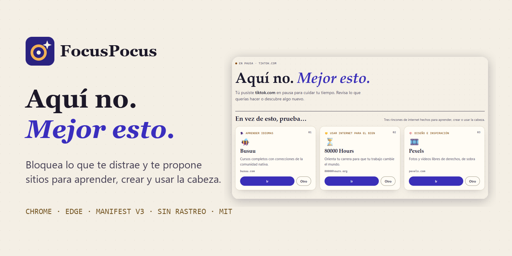
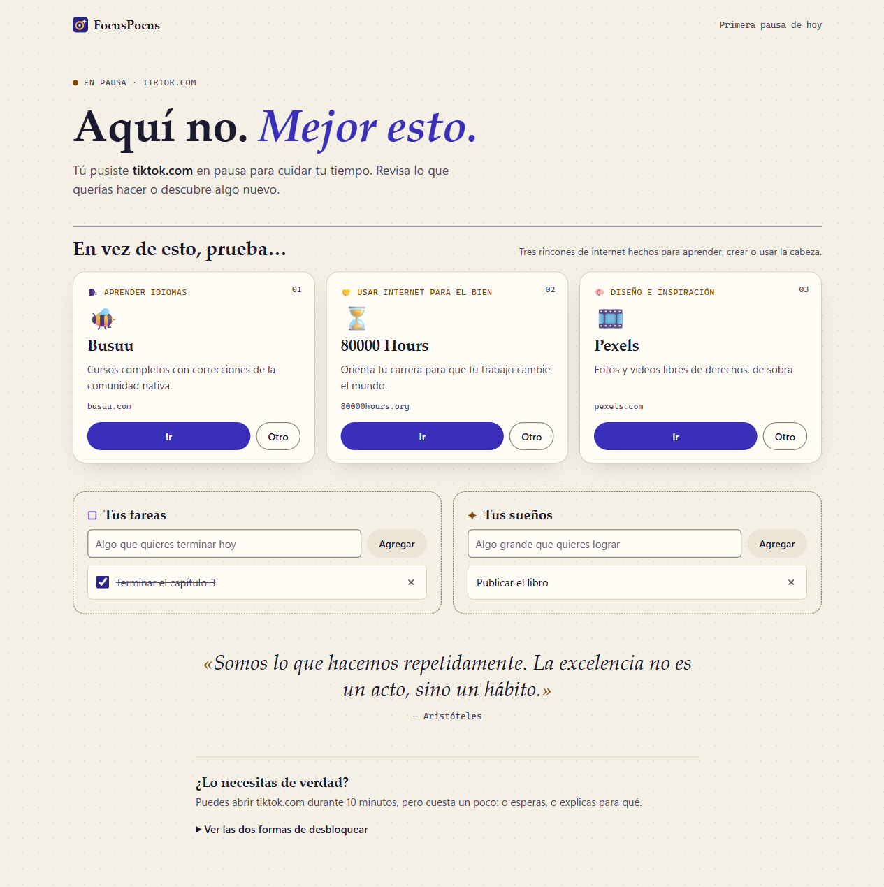
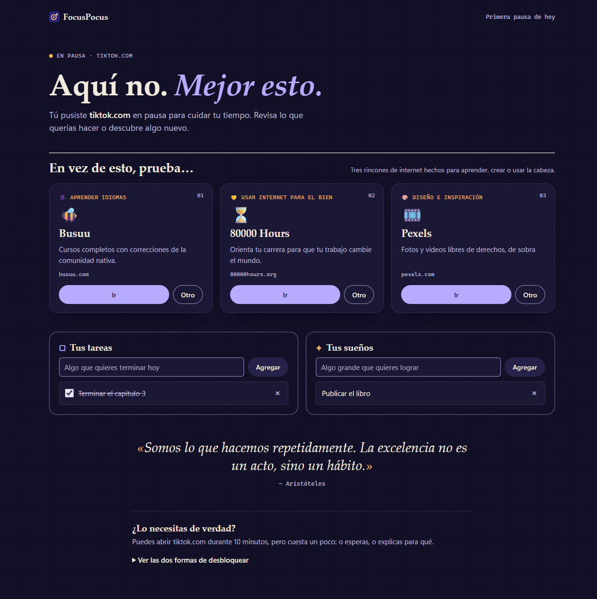
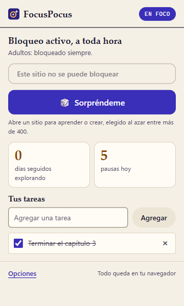
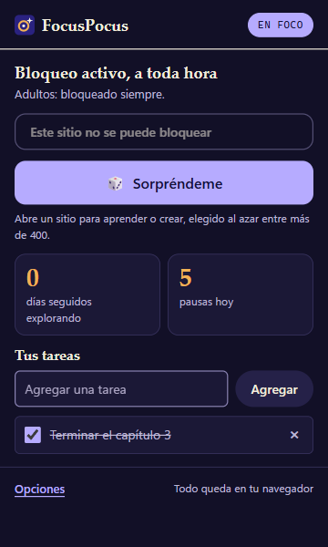
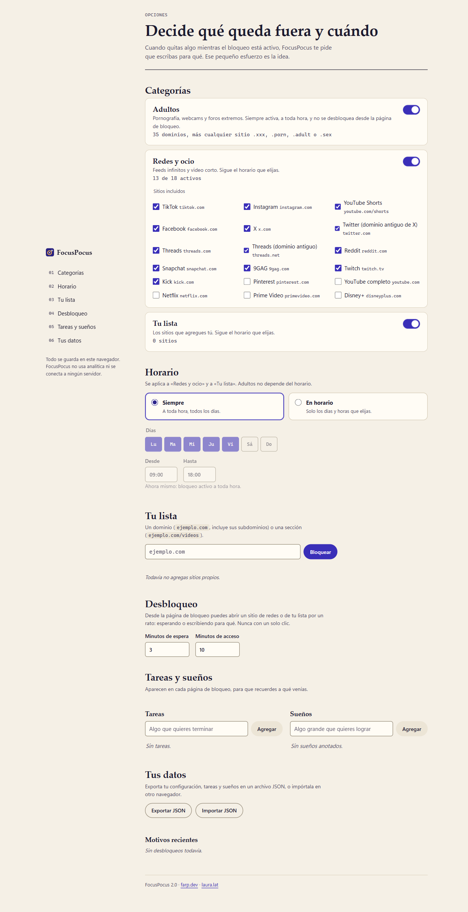

<p align="center">
  
</p>

<p align="center">
  <a href="https://github.com/freyesperales/FocusPocus/releases/latest"></a>
  
  
  
  <a href="LICENSE"></a>
</p>

# FocusPocus

**Abres TikTok por costumbre y, en vez de un muro, aparece algo que vale tu tiempo.**

FocusPocus es una extensión gratuita para Chrome y Edge. Bloquea el contenido para adultos, los feeds infinitos y los sitios que tú elijas. En lugar de dejarte frente a una página de error, te recuerda tus tareas y te propone tres rincones de internet para aprender, crear o usar la cabeza, sacados de un catálogo de más de 450 sitios curados a mano.

Sin cuentas, sin servidores y sin analítica: todo queda en tu navegador.

[**Descargar la última versión**](https://github.com/freyesperales/FocusPocus/releases/latest) · [Instalar en 1 minuto](#instalación-sin-empaquetar) · [Ver capturas](#capturas)

## Por qué es distinta

La mayoría de los bloqueadores te dejan frente a un muro, y el muro se salta en dos clics. FocusPocus parte de otra idea: **el impulso de abrir una red no desaparece, se redirige.**

| | Bloqueador típico | FocusPocus |
|---|---|---|
| Al entrar a un sitio bloqueado | Página de error | Tus tareas, tus sueños y 3 sitios que valen la pena |
| Desbloquear | Un clic | Esperar unos minutos o escribir para qué lo necesitas |
| Contenido para adultos | Opcional | Activado siempre, sin desbloqueo desde la página de bloqueo |
| Tus datos | Muchas veces en un servidor | Solo en tu navegador |
| Precio | Suscripción frecuente | Gratis y de código abierto |

## Un ejemplo real

Son las 11:00 de un martes y tienes el horario de trabajo activo (lunes a viernes, de 9:00 a 18:00).

1. Escribes `tiktok.com` sin pensarlo.
2. FocusPocus te muestra «Aquí no. Mejor esto.», tu tarea pendiente («Terminar el informe») y tres sugerencias: un curso de idiomas, una guía para orientar tu carrera y un banco de fotos libres.
3. Si de verdad lo necesitas, eliges «Escribir para qué lo necesitas», lo explicas y tienes 10 minutos. El motivo queda guardado en tu equipo para que lo revises después.
4. A las 18:00 el bloqueo de redes se apaga solo. El de adultos sigue, a toda hora.

## Para quién es

- Quien trabaja frente al computador y pierde horas en feeds sin darse cuenta.
- Estudiantes que quieren usar internet para aprender, no solo para entretenerse.
- Madres, padres y educadores que quieren un navegador más sano en casa o en clase.
- Quien busca dejar el contenido para adultos y necesita una barrera que no se salte en un clic.

## Capturas

| Página de bloqueo | Modo oscuro |
|---|---|
|  |  |

| Popup | Popup oscuro | Opciones |
|---|---|---|
|  |  |  |

## Qué hace

**Bloqueo por categorías**

- **Adultos.** Pornografía, webcams y foros extremos, además de cualquier sitio `.xxx`, `.porn`, `.adult` o `.sex`. Viene activada, funciona a toda hora y no se desbloquea desde la página de bloqueo.
- **Redes y ocio.** TikTok, Instagram, YouTube Shorts, Facebook, X, Threads, Reddit, Twitch y otros feeds infinitos. Puedes activar o desactivar cada sitio. Pinterest, YouTube completo y las plataformas de streaming vienen desactivados.
- **Tu lista.** Los dominios (`ejemplo.com`, con sus subdominios) o secciones (`ejemplo.com/videos`) que agregues tú.

Redes y tu lista siguen el modo que elijas: **Siempre**, o **En horario** con días y horas configurables (también horarios nocturnos que cruzan la medianoche).

**Desbloquear cuesta un poco.** Desde la página de bloqueo puedes abrir un sitio de redes o de tu lista durante unos minutos, pero nunca con un clic: o esperas (la cuenta solo avanza con la pestaña a la vista) o escribes para qué lo necesitas. Quitar algo de la lista mientras el bloqueo está activo también pide un motivo.

**La página de bloqueo**

- «En vez de esto, prueba…»: tres sitios del catálogo, de categorías distintas, con su explicación y un botón «Otro» para cambiar cada uno.
- Tus tareas y tus sueños, para recordar a qué venías.
- Una cita.

**El popup** muestra el estado del bloqueo, permite bloquear con un clic el sitio que estás viendo, tiene el botón «🎲 Sorpréndeme» (un sitio educativo al azar), tus tareas y tu racha de días explorando.

**La página de opciones** reúne las categorías, el horario, tu lista, los tiempos de desbloqueo, tus tareas y sueños, y permite exportar o importar todo en JSON.

## El catálogo

Las sugerencias salen de un catálogo de más de 450 sitios curados a mano en 38 categorías, el mismo de Brújula (The Fun Dude). Está copiado en `data/sites.js`, junto con las citas (`data/quotes.js`) y la lista base de adultos (`data/blocklist.json`). FocusPocus nunca sugiere la categoría de ocio puro ni un sitio que tú tengas bloqueado.

## Instalación (sin empaquetar)

1. Descarga el ZIP de la [última versión](https://github.com/freyesperales/FocusPocus/releases/latest) y descomprímelo, o clona este repositorio.
2. Abre `edge://extensions` en Edge o `chrome://extensions` en Chrome.
3. Activa el **Modo de desarrollador**.
4. Pulsa **Cargar desempaquetada** (en Chrome, **Cargar extensión sin empaquetar**) y elige la carpeta del repositorio, la que contiene `manifest.json`.
5. Se abre la página de opciones. Fija el icono en la barra para tener el popup a mano.

Requiere Chrome o Edge 116 o posterior (Manifest V3).

## Privacidad y permisos

Todo se guarda en `chrome.storage.local`, en tu navegador. FocusPocus no tiene analítica, no usa servidores y no hace peticiones a la red. Los motivos que escribes para desbloquear quedan solo en tu equipo.

| Permiso | Para qué |
|---|---|
| `declarativeNetRequest` | Bloquear los sitios con reglas del propio navegador. La extensión no lee el contenido de las páginas. |
| `storage` | Guardar tu configuración, tareas y sueños. |
| `alarms` | Revisar cada minuto el horario y el fin de los desbloqueos temporales. |
| `activeTab` | Saber qué sitio estás viendo cuando abres el popup, para bloquearlo con un clic. |
| Acceso a los sitios de las listas predefinidas | El navegador solo permite llevar un sitio bloqueado a la página de sugerencias si la extensión tiene acceso a ese dominio. Por eso se pide acceso únicamente a los dominios de adultos y de redes, y no a todos los sitios. |
| Acceso opcional a otros sitios | Se pide uno por uno al agregar un sitio a tu lista. Si no lo concedes, el sitio se bloquea igual, pero con la página de error del navegador en vez de la de FocusPocus. |

## Estructura

```
manifest.json      Manifest V3
background.js      Service worker: reglas dinámicas, horario y desbloqueos
blocked.*          Página de bloqueo
popup.*            Popup de la barra
options.*          Página de opciones
lib/               Lógica compartida (estado, reglas, listas, descubrimiento)
data/              Catálogo, citas y lista base de adultos (de Brújula)
styles/            Hojas de estilo
icons/             Iconos (icon.svg es la fuente)
```

## Ayúdala a llegar a más gente

Si FocusPocus te sirve, dale una ⭐ al repositorio y compártela con alguien que la necesite. Las ideas y los errores se reciben en [Issues](https://github.com/freyesperales/FocusPocus/issues).

## Licencia

MIT. Ver [LICENSE](LICENSE).

## Autor

Francisco Reyes · [farp.dev](https://farp.dev) · [laura.lat](https://laura.lat)
